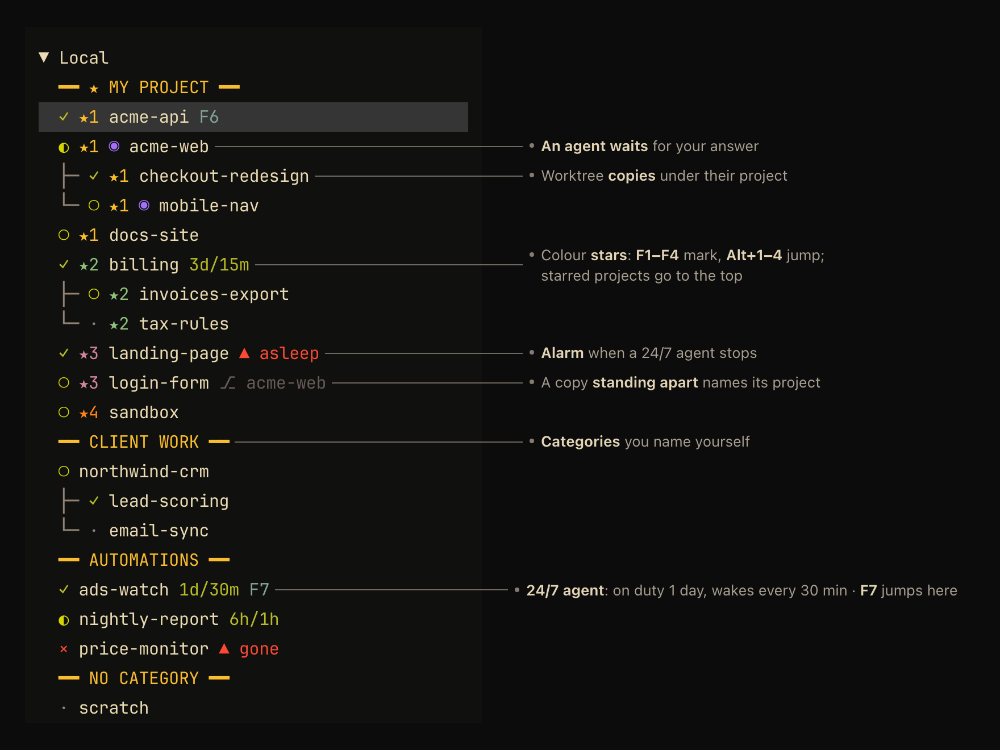
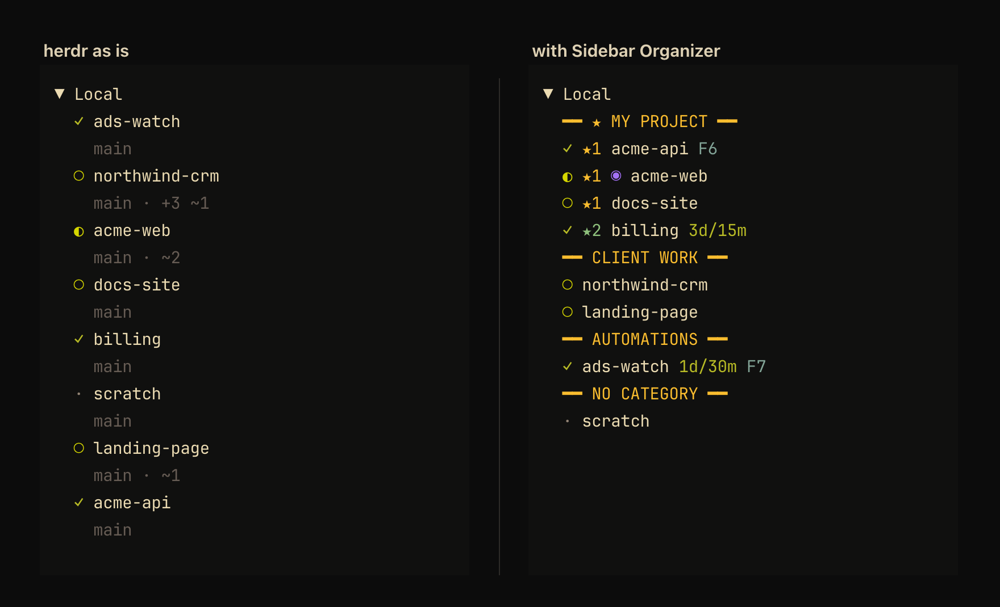
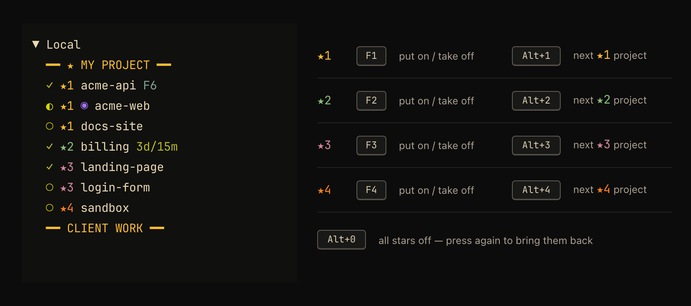
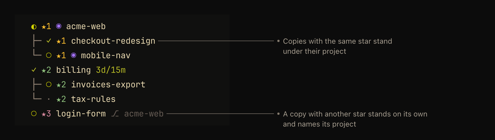
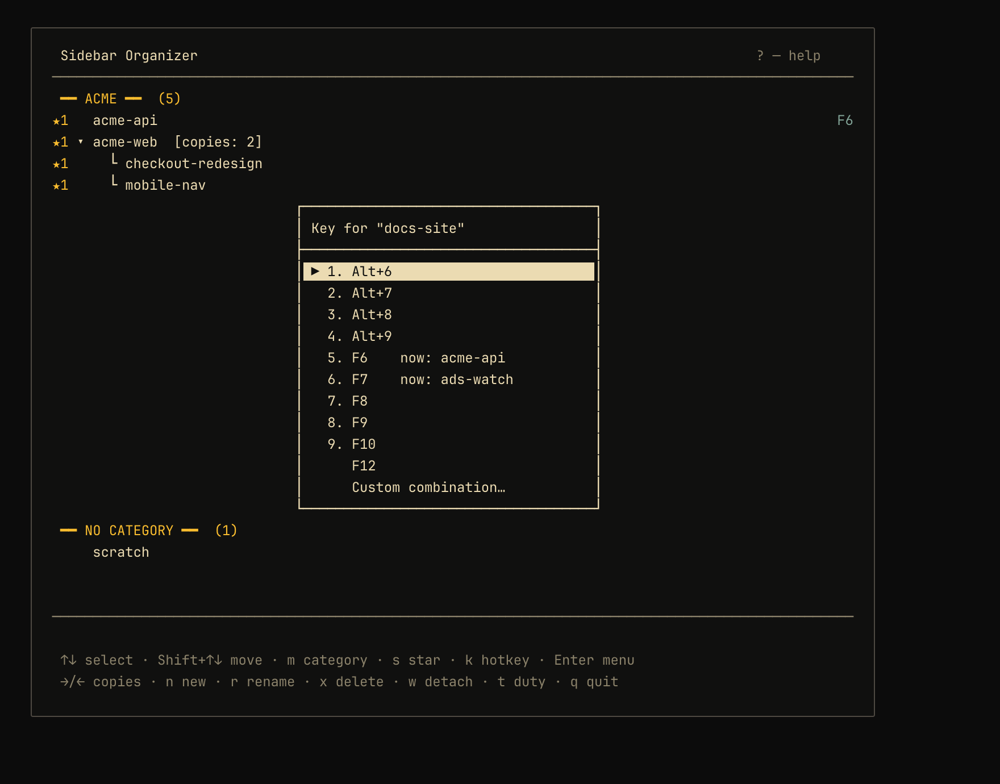
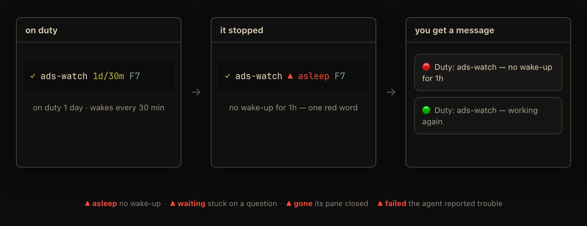
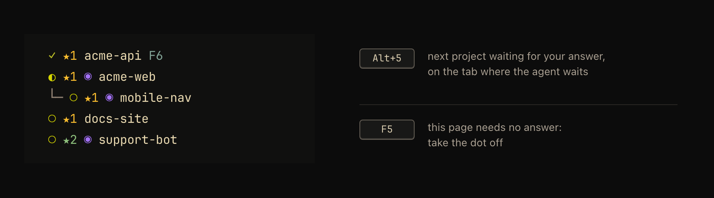
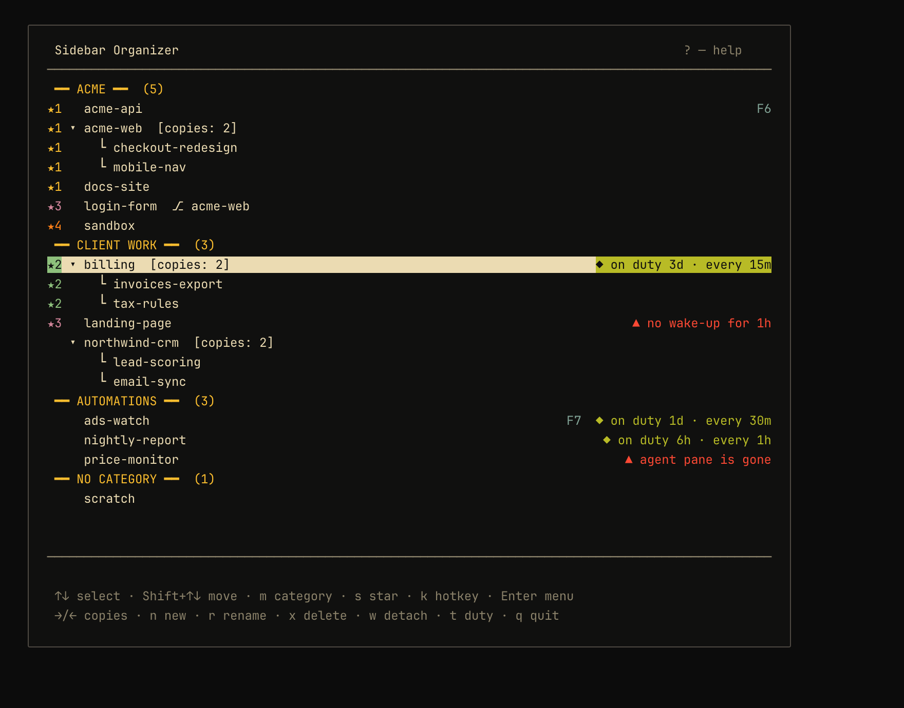

<div align="center">

# Sidebar Organizer

### Order for a herdr sidebar of dozens of AI agents.

Categories, colour stars, one-key jumps and alarms for agents that work around the clock —
right in the [herdr](https://herdr.dev) Spaces sidebar, managed from one popup window with the
keyboard or the mouse.


<br><br>



</div>

If you run twenty agents at once, the sidebar becomes one long list in the order you happened to
open things, and finding the one that needs you means reading all of it. This plugin gives the
list a shape you choose and keeps it that way.

```sh
herdr plugin install patraianton/herdr-sidebar
herdr plugin action invoke setup --plugin anton.sidebar
```

Then press `Ctrl+B`, then `Shift+S` to open the window.

## Before and after

<div align="center">

</div>

- Projects stand under titled categories in the order you set, not in the order they were opened.
- Each project takes one line. The branch line herdr draws under every name is left out; what
  matters stands right of the name: a star, a hotkey, a duty mark or an alarm.
- The projects you work on most go to a block at the very top.

## Categories

- Make as many as you like and name them after your businesses, clients or kinds of work:
  `━━ CLIENT WORK ━━`, `━━ AUTOMATIONS ━━`. In the window: `n` new, `r` rename, `x` delete.
- Move a project between categories with `m`, or drag it: in the window, or right in the herdr
  sidebar — a project dropped among another category's projects joins that category.
- Move whole categories up and down with `Shift+↑` / `Shift+↓` (or `J` / `K`).
- New projects you have not sorted yet wait at the bottom under `━━ NO CATEGORY ━━`, in herdr's own
  order.
- herdr has no title rows of its own, so a title is a line the plugin draws on top of the category's
  first project. `U` in the window switches the plugin off and puts the sidebar order and
  `config.toml` back as they were.

## Colour stars

<div align="center">

</div>

- Four kinds of stars, each with its own colour — say, your own project and three jobs. Name the
  kinds in the window: `s`, then **Rename the kinds of stars…**.
- `F1`…`F4` puts a star of that kind on the project that is open right now. The same key again takes
  it off; another F-key changes the kind. You do not need to open the window.
- `Alt+1`…`Alt+4` goes round the projects with that star: inside a project of that kind it opens the
  next one down the sidebar (and round to the first); from anywhere else it goes back to the one you
  visited last.
- `Alt+0` takes every star off at once. Pressed again while there are no stars, it brings back
  exactly what it took off.
- **Stars at the top.** In the window press `s`, then **Stars at the top of the sidebar…**, and pick
  kinds. Every project with such a star leaves its category in the sidebar and stands in a block at
  the very top, one block per kind, under one title (`━━ ★ MY PROJECT ━━`). Take the star off and
  the project returns to its place in its category. In the window it stays in its category all the
  time, so that is where it returns.

| Kind | Put on / take off | Go round them | Colour |
|---|---|---|---|
| ★1 | `F1` | `Alt+1` | yellow |
| ★2 | `F2` | `Alt+2` | teal |
| ★3 | `F3` | `Alt+3` | pink |
| ★4 | `F4` | `Alt+4` | orange |

## Worktree copies

<div align="center">

</div>

- A git worktree copy of a project (the way agents often work on a branch side by side) stands
  right under its project, drawn with `├─` and `└─`. Dragging the project takes its copies along.
- Only what has the star goes up. A copy with the same star as its project goes up with it; a copy
  with another star, or with a star while its project has none, stands on its own line and names
  its project after its name: `⎇ acme-web`. Copies you did not star are not pulled up with the
  project.
- In the window `→` / `←` shows or hides a project's copies, and `w` detaches a copy from its
  project or puts it back.

With stock herdr, a copy that must stand apart from its project has to be taken out of herdr's
worktree group. The plugin does that by itself (as with `w`: the panes and the agents in them keep
running) and does not put it back by itself; `w` does, once the two belong together again. Each
move gives the panes new ids in herdr, while an agent already running there keeps the old ones in
its environment (`HERDR_PANE_ID` still resolves, `HERDR_WORKSPACE_ID` does not), so the plugin moves
a copy at most once. Scripts that need the current workspace should ask `herdr pane current`. Copies
you detached yourself are never touched. With the [extended herdr build](#the-extended-herdr-build)
nothing has to be moved at all.

## Jump hotkeys

<div align="center">

</div>

- Select a project in the window, press `k` and pick a key. The menu offers only keys that are
  free — not taken by herdr, by another plugin or by the stars — and shows which project holds a
  key already. **Custom combination…** takes any other key, like `ctrl+alt+k` or `prefix+alt+1`.
- A project with several tabs asks whether the key should open the project or one particular tab.
- The key shows right of the project's name in the sidebar (`F7`).
- Hotkeys survive renames and herdr restarts. Under the hood each one is a `[[keys.command]]`
  entry in `config.toml` that runs the plugin action `jump-N`; if herdr refuses a new binding, the
  file goes back as it was.

## Duty agents (24/7)

<div align="center">

</div>

An agent that works around the clock — an ads watch, a monitor, a nightly loop — checks in from its
own pane:

```sh
herdr-duty start --every 30m --note "watching the ads account"
herdr-duty ok                      # optional "I am alive" after each round
herdr-duty fail "no access to the ads account"
herdr-duty stop
herdr-duty status
```

- Its line shows how long it has been on duty and how often it wakes: `1d/30m` — on duty one day,
  wakes every 30 minutes.
- The plugin raises one alarm per incident when the agent:
  - has not woken up for its interval plus half of it (at least 10 minutes more) — `▲ asleep`;
  - has been waiting for an answer for more than 10 minutes — `▲ waiting`;
  - lost its pane for more than 3 minutes — `▲ gone`;
  - reported trouble itself with `herdr-duty fail` — `▲ failed`.
- The alarm turns the mark into one red word, herdr shows a notice, and (optionally) Telegram sends
  `🔴 Duty: ads-watch — no wake-up for 1h`. When the agent works again you get one
  `🟢 Duty: ads-watch — working again`.
- A short grace period after herdr or the computer wakes up keeps restarts from looking like
  failures.
- You can also put an agent on duty by hand: select it in the window and press `t` (start, change
  the interval, reset an alarm, end).

A line like this in your agents' instructions (`CLAUDE.md`, `AGENTS.md`) is enough:

> When you are asked to watch something around the clock and you work in rounds, run
> `herdr-duty start --every <your interval> --note "<what you watch>"` once, `herdr-duty ok` after
> every round, `herdr-duty fail "<reason>"` when you are stuck and need a human, and
> `herdr-duty stop` when the job is over.

### Telegram alerts (optional)

Put a `.env` file into the plugin's config folder (`herdr plugin config-dir anton.sidebar` prints it):

```sh
TELEGRAM_BOT_TOKEN=123456:ABC...
TELEGRAM_CHAT_ID=123456789
```

The bot key is read at every send and never copied or logged. If your bot key already lives in
another `.env`, point at it with `telegram.json` in the same folder:

```json
{ "chatId": 123456789, "envFile": "/path/to/.env", "envKey": "MY_BOT_TOKEN" }
```

`{ "enabled": false }` switches Telegram off.

## Waiting for your answer

<div align="center">

</div>

For agents that ask for your review on a [Lavish](https://github.com/kunchenguid/lavish-axi) page
(Windows only for now).

- A violet `◉` after the star marks a project where an agent waits for your answer.
- `Alt+5` opens the next such project down the sidebar (and round to the first), on the tab where
  the agent waits.
- Some pages need no answer — a report you have read. `F5` takes the dot off the open project at
  once (a notice names the pages); the page stays open. The dot comes back when the agent changes
  the page, or when you press `F5` there again.
- The dot follows the page, not the waiting process: an agent that waits in rounds, or stops waiting
  and picks your answer up later, keeps its dot. Once you send the answer, or end the page, the dot
  goes on the next round, even if the agent keeps waiting in case you add something.

<details>
<summary>How the plugin finds the waiting agent</summary>

When an agent shows you a Lavish page it waits for your feedback with `lavish-axi poll <page>`.
Every process started in a herdr pane inherits `HERDR_PANE_ID`, so the waiting process names its own
pane, even when the page lives outside the project's folder. Every 30 seconds the helper finds those
processes, reads that variable from them (a short PowerShell probe; Windows does not show another
process's environment otherwise) and remembers each page with the pane that waited on it. The dot
stays while the page is open in `~/.lavish-axi/state.json` (or `LAVISH_AXI_STATE_DIR`) and you have
not answered it since the page last changed. On macOS and Linux nothing is marked.

The helper keeps what it knows in `lavish-pages.json` in its session folder (under herdr's plugin
state folder): the remembered pages, the panes with the dot, and `links` — for each pane, the
addresses of every open page it waited on (the public address when lavish-axi has one), with
`waiting: true` on those that want an answer; those come first, the newest first. A status line can
read `links[$HERDR_PANE_ID]` to show the agent's open pages right in its window.

</details>

## Work on remote machines

When an agent starts work on another machine over ssh — a Codex run on a Mac mini, a build on a
server — its project gets `@mac` right of its name while that work runs. A project that looks idle
here is then not mistaken for one that has stopped.

- Two machines at once: `@mac+dev`.
- The mark comes about a minute after the run starts and goes about a minute after it ends.
- A process counts once it has been seen twice in a row, so the quick `ssh mac pgrep …` an agent
  uses to check on its run does not make the mark blink.
- A detached copy keeps its mark: the run carries the pane id it started with, and herdr still
  answers for it.

Three lines turn it on:

1. Your shell profile copies the pane id into a variable ssh may send. PowerShell:
   `if ($env:HERDR_PANE_ID) { $env:LC_HERDR_PANE = $env:HERDR_PANE_ID }`; bash or zsh:
   `[ -n "$HERDR_PANE_ID" ] && export LC_HERDR_PANE="$HERDR_PANE_ID"`.
2. `~/.ssh/config` sends it:

   ```
   Host *
       SendEnv LC_HERDR_PANE
   ```

   Most servers already take `LC_*` variables (`AcceptEnv LANG LC_*` in `sshd_config` on macOS,
   Debian and Ubuntu), so nothing changes on the server.
3. `settings.json` names the machines: `"remotes": ["mac", { "name": "dev", "ssh": "root@codex-dev" }]`
   — a plain name is also the ssh host; `name` is what the mark shows (up to 8 letters).

Once a minute the helper asks each machine over ssh (key login only, it never asks for a password)
which processes carry the variable: `/proc` on Linux, `ps` on macOS. On Linux log in as root or as
the user who runs the work. macOS hides the environment of its own system programs, so a bare
`sleep` is not seen; a `codex`, `node` or `python` run is. Only panes opened after the profile
change carry the id. A machine that does not answer keeps its marks for three rounds and is
written once to the helper's log.

## The window

<div align="center">

</div>

`Ctrl+B`, then `Shift+S` — or right-click a workspace and pick **Sidebar Organizer**. Everything
above is set up here; `?` lists every key.

| Key | What it does |
|---|---|
| `↑` `↓`, `PgUp` `PgDn`, `Home` `End` | select a row |
| `Shift+↑` `Shift+↓` or `J` `K` | move a project or a whole category |
| mouse | click to select, drag a row to move it |
| `m` | move the project to another category |
| `n` `r` `x` | new category, rename, delete |
| `→` `←` | show or hide a project's worktree copies |
| `w` | detach a worktree copy from its project / put it back |
| `t` | duty: start, change the interval, reset an alarm, end |
| `k` | jump hotkey for the project or one of its tabs |
| `s` | star: pick a kind, take it off, rename the kinds, stars at the top |
| `Enter` | menu of everything above for the selected row |
| `U` | switch the plugin off and put everything back |
| `q` / `Esc` | close |

Keys that work with the window closed:

| Key | What it does |
|---|---|
| `F1`…`F4` | star of that kind on the open project, or off |
| `Alt+1`…`Alt+4` | next project with that star |
| `Alt+0` | every star off; again — bring them back |
| `Alt+5` | next project where an agent waits for your answer |
| `F5` | take the waiting dot off the open project, or bring it back |
| your hotkeys | jump to their project or tab |

## Install, update, remove

**Requirements:** herdr 0.9.1 or newer, Node.js 20 or newer.

```sh
herdr plugin install patraianton/herdr-sidebar
herdr plugin action invoke setup --plugin anton.sidebar
```

`setup` adds the plugin's sidebar rows and key bindings to herdr's `config.toml` (between
`# >>> anton.sidebar` marker comments, with a dated backup next to the file), reloads herdr and puts
the `herdr-duty` command into `~/.local/bin`. A notice tells you when it is done.

**Update:** run `herdr plugin install patraianton/herdr-sidebar` again, then the same `setup`
action: it brings the config rows and bindings up to date and restarts the plugin's helper.

**Remove:** press `U` in the window (type `yes`). The sidebar order, `config.toml` and the
`herdr-duty` command go back to how they were. Then `herdr plugin uninstall anton.sidebar`.

## Settings

`settings.json` in the plugin's config folder (all fields optional):

```json
{
  "starNames": ["My project", "Job 1", "Job 2", "Job 3"],
  "starsOnTop": [1],
  "tickSec": 30,
  "blockedMin": 10,
  "missingMin": 3,
  "graceMin": 10,
  "silenceMarginMin": 10,
  "remotes": ["mac", { "name": "dev", "ssh": "root@codex-dev" }],
  "remoteTickSec": 60
}
```

`starNames` and `starsOnTop` are easiest to set from the window (`s` → **Rename the kinds of
stars…** and **Stars at the top of the sidebar…**). The duty thresholds and the remote machines
are read when the helper starts — run the `setup` action again to restart it.

## The extended herdr build

The pictures show the plugin with a herdr build that has a few sidebar settings stock herdr does
not have yet: [patraianton/herdr](https://github.com/patraianton/herdr), branch `anton/build`
(stock herdr 0.9.3 plus these changes; only the client program is swapped, the server stays stock).

- Every worktree copy can stand on a line of its own (`group_worktrees = false`), so nothing has to
  be detached: no pane moves, every agent keeps its ids, and a star puts exactly the starred line on
  top.
- Copies are drawn under their project: the plugin keeps them right after the project and marks
  them with the token `nested`.
- A single space between the parts of a row instead of ` · ` (`separator = " "`).
- When a row is too long, the name is cut first; the star, the duty mark and the alarm stay whole.

Setup reads `herdr --default-config`, sees which of these the running herdr knows and turns on only
those. With stock herdr everything else works as described, the parts of a row are separated by
` · `, and copies that must stand apart are detached as described under
[Worktree copies](#worktree-copies).

## How it works

- A small background helper (one per herdr session) watches workspace events, keeps the order of the
  sidebar, and publishes custom tokens — `$section`, `$star`, `$lavish`, `$remote`, `$key`,
  `$project`, `$duty` — that the plugin's sidebar rows display.
- Plugin state lives in herdr's plugin state folder (one folder per session); your settings live
  in the plugin config folder. Nothing is written into the plugin checkout.
- The window, the hotkeys and `herdr-duty` talk to the helper over a local pipe; if the helper is
  not running, they start it.

## Development

```sh
git clone https://github.com/patraianton/herdr-sidebar
herdr plugin link ./herdr-sidebar
herdr plugin action invoke setup --plugin anton.sidebar

npm test                         # unit tests, no herdr needed
node test/integration/run.js     # Windows: end-to-end run in throwaway herdr sessions
```

The end-to-end run starts two isolated herdr sessions (`sbplug` and `sbview`), presses real keys in
them and never touches your own session.

## License

[MIT](LICENSE) © Anton Patrai

<div align="center">
<sub>Pictures: the sidebar drawn from its real text, and the plugin's own window, with made-up project names.</sub>
</div>
